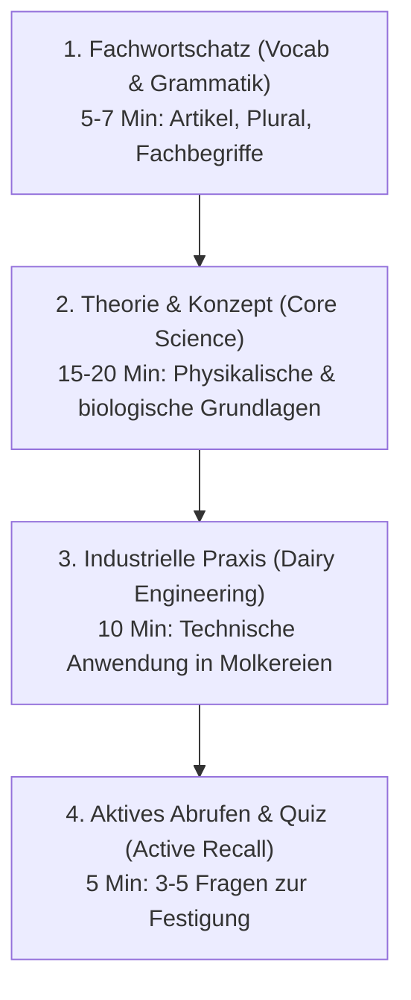

# Täglicher Lernplan & Studienführer (Daily Study Plan & Roadmap)
## B.Tech in Milchwissenschaft & Lebensmitteltechnologie (Dairy Science & Food Technology)

Dieses Dokument strukturiert deine tägliche Lerneinheit (Daily Routine). Wir lernen Schritt für Schritt, modular und fokussiert.

---

## 1. Die tägliche 4-Schritte-Methode (The 4-Step Daily Routine)

Jede tägliche Lerneinheit dauert idealerweise **30 bis 45 Minuten** und folgt diesem festen Schema:



1. **Schritt 1: Fachwortschatz (Vocabulary & Terminology)**
   - 5 bis 8 zentrale Fachbegriffe mit Artikel (`der/die/das`), Plural und deutscher Aussprache/Eselsbrücke.
   - Beispiel: `das Kasein (pl. Kaseine)` = casein, `das Milchfettkügelchen` = milk fat globule.

2. **Schritt 2: Das Kernkonzept (Theory & Scientific Foundation)**
   - Wissenschaftliche Erklärung auf Deutsch mit direkter englischer Übersetzung / Zusammenfassung.
   - Formeln, Reaktionen, thermodynamische und kolloidchemische Gesetzmäßigkeiten.

3. **Schritt 3: Industrielle Praxis (Dairy Engineering & Food Processing)**
   - Wie wird das im Molkereibetrieb (z. B. bei Müller Milch, Hochwald, Arla oder DMK in Deutschland) angewendet?
   - Maschinen, Rohrleitungen, Temperaturregimes, Pasteurisation, Zentrifugen, Membrantrennung.

4. **Schritt 4: Deutsch-Übung & Wissensquiz (Active Recall & Daily Check)**
   - 3 Fragen:
     - 1x Deutsche Übersetzung & Grammatik
     - 1x Naturwissenschaftliche Fachfrage
     - 1x Technologischer Praxisbezug

---

## 2. Struktur der Semesterordner (Directory Structure)

Die Ordnerstruktur in deinem Verzeichnis `d:/B.tech in german/` ist wie folgt gegliedert:

```text
d:/B.tech in german/
│
├── 00_Syllabus_Curriculum/
│   ├── Curriculum_Overview_Lehrplan.md
│   └── Daily_Learning_Strategy_Lernplan.md
│
├── Semester_01_Grundlagen/
│   ├── 01_Physikalische_Chemie_der_Milch/
│   │   ├── Lektion_01_Zusammensetzung_und_kolloidales_System.md
│   │   ├── Lektion_02_Milchfett_und_Emulsionsstabilitaet.md
│   │   ├── Lektion_03_Kaseinmizellen_und_Saeure_Labgerinnung.md
│   │   └── Fachwoerterbuch_Milchchemie.md
│   │
│   ├── 02_Grundlagen_der_Mikrobiologie/
│   │   ├── Lektion_01_Einfuehrung_in_die_Mikrobiologie.md
│   │   ├── Lektion_02_Bakterielle_Morphologie_und_Wachstum.md
│   │   └── Fachwoerterbuch_Mikrobiologie.md
│   │
│   ├── 03_Thermodynamik/
│   │   └── ...
│   │
│   ├── 04_Stroemungsmechanik/
│   │   └── ...
│   │
│   └── 05_Molkereientwicklung_und_Milchproduktion/
│       └── ...
│
├── Semester_02_Grundlagen_II/
├── Semester_03_Technologie_I/
├── Semester_04_Fermentation_Kaeserei/
├── Semester_05_Anlagenbau_Qualitaet/
├── Semester_06_Lebensmitteltechnologie/
├── Semester_07_Praxis_Training/
└── Semester_08_Industriepraktikum_Projekt/
```

---

## 3. Fortschritts-Tracker (Study Progress Tracker)

| Datum / Tag | Fach (Subject) | Thema (Topic) | Status |
| :--- | :--- | :--- | :---: |
| **Tag 1 (Heute)** | Physikalische Chemie der Milch | Zusammensetzung & Kolloidchemie der Milch | [x] Aktiv |
| **Tag 2** | Grundlagen der Mikrobiologie | Einführung & Bakterien in Rohmilch | [ ] Bereit |
| **Tag 3** | Physikalische Chemie der Milch | Milchfettkügelchen & Emulsion (MFGM) | [ ] Offen |
| **Tag 4** | Thermodynamik & Wärmeübertragung | Erster Hauptsatz & Pasteurisierung | [ ] Offen |
| **Tag 5** | Physikalische Chemie der Milch | Kaseinmizellen & Gelbildung (Lab/Säure) | [ ] Offen |
| **Tag 6** | Strömungsmechanik | Newtonsche & Nicht-Newtonsche Fluide in Milchleitungen | [ ] Offen |
| **Tag 7** | Wöchentliche Wiederholung | Vokabeltest & technisches Fachgespräch auf Deutsch | [ ] Offen |

---

> [!TIP]
> Du kannst mir jederzeit deine Vorlesungs-PDFs, Skripte oder ICAR/NDRI/eCourse-Unterlagen nennen oder hochladen. Ich passe den Stoff exakt an deine Prüfungsschwerpunkte an!
