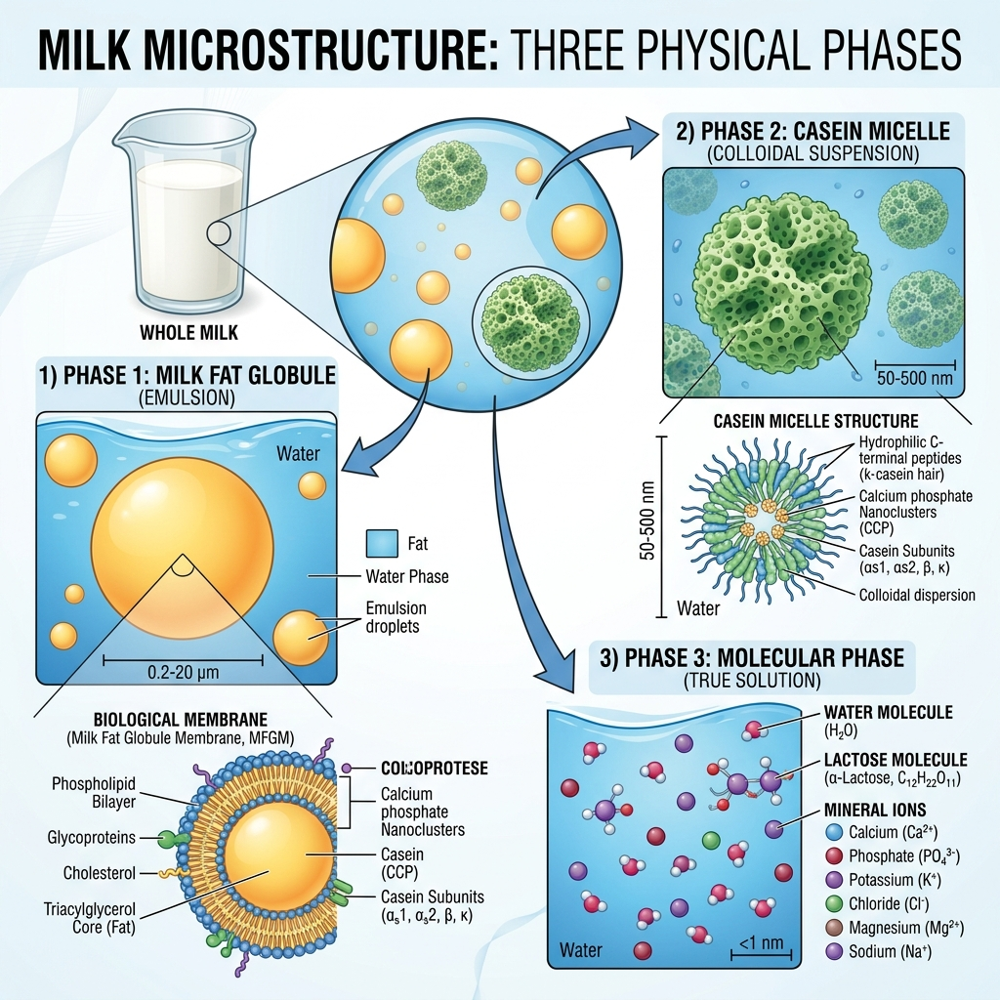

# Tag 01: Physikalische Chemie der Milch (Physical Chemistry of Milk)
**Datum:** 06. Oktober 2026 | **Fach:** Semester I – Physikalische Chemie der Milch  
**Thema:** Definition, Zusammensetzung und das kolloidale Mehrphasensystem *(Gross Composition & The Multiphase System)*

---

## 🖼️ Wissenschaftliche Infografik (Microstructural Graphic)

Hier ist die mikrostrukturelle Übersicht über die drei physikalischen Phasen der Milch:

---

## 1. Übersicht: Das Dreiphasensystem der Milch (The 3 Physical Phases)

Milch ist kein homogenes Gemisch, sondern ein **polydisperses biologisches Mehrphasensystem**. Die drei Phasen unterscheiden sich fundamental in Teilchengröße, Stabilitätsmechanismus und technologischer Verhaltensweise:

| Phase | Deutsche Bezeichnung | Hauptkomponenten | Teilchengröße | Stabilitätsmechanismus | Molkereitechnische Bedeutung |
| :---: | :--- | :--- | :---: | :--- | :--- |
| **1** | **Die Emulsion (Öl-in-Wasser)** | Triacylglyceride (Milchfett) | $0{,}1 - 10\ \mu\text{m}$ | **MFGM** (Milchfettkügelchenmembran mit Phospholipiden & Glykoproteinen) | **Entrahmung:** Trennung im Zentrifugalseparator. **Homogenisierung:** Zerkleinerung unter hohem Druck (150–250 bar). |
| **2** | **Die kolloidale Dispersion** | Kaseinmizellen ($\alpha_{s1}, \alpha_{s2}, \beta, \kappa$-Kaseine) & Calciumphosphat (CCP) | $50 - 300\ \text{nm}$ | **$\kappa$-Kasein-Haarschicht** (sterische Hinderung & negative Oberflächenladung) | **Weißes Aussehen:** Lichtstreuung (Tyndall-Effekt). **Käseherstellung:** Gelbildung durch enzymatische Labspaltung oder Säuerung. |
| **3** | **Die echte Lösung** | Laktose (Milchzucker), Mineralsalze ($\text{Na}^+, \text{K}^+, \text{Cl}^-$), wasserlösliche Vitamine | $< 1\ \text{nm}$ | Molekular & ionisch hydratisiert in der kontinuierlichen Wasserphase | **Osmotischer Druck & Gefrierpunkt:** Konstante Gefrierpunktserniedrigung ($-0{,}520$ bis $-0{,}540\ ^\circ\text{C}$) zur Detektion von Fremdwasser. |

---

## 2. Detaillierte Phasenanalyse (Detailed Scientific Breakdown)

### Phase 1: Die Emulsion (The Emulsion)
- **Die Fettphase (Lipid Phase):** Milchfett besteht zu über 98 % aus Triglyceriden (Glycerinestern von Fettsäuren wie z.B. Myristinsäure, Palmitinsäure, Ölsäure und Buttersäure).
- **Die MFGM (Milchfettkügelchenmembran):** Eine dreischichtige biologische Membran aus Phospholipiden, Sphingomyelin, Cholesterin und spezifischen Membranproteinen (z.B. Butyrophilin, Xanthinoxidase).
- **Technologie:** Unbeschädigte MFGM schützt vor enzymatischer Spaltung durch native Lipasen. Mechanische Belastung (z.B. starkes Pumpen) kann die Membran beschädigen, was zu ranzigem Geschmack führt (hydrolytische Ranzigkeit / Lipolyse).

### Phase 2: Die kolloidale Suspension (The Colloidal Dispersion)
- **Aufbau der Kaseinmizelle:** Kaseine lagern sich mithilfe von nanokristallinem kolloidalem Calciumphosphat (CCP) zu sphärischen Gebilden zusammen.
- **Die Schutzschicht ($\kappa$-Kasein):** Während $\alpha$- und $\beta$-Kaseine stark hydrophob und calcium-empfindlich sind, ragt das hydrophile, glykosylierte C-terminale Ende des $\kappa$-Kaseins wie "Haare" in die wässrige Lösung hinein. Dies verhindert die spontane Aggregation.
- **Koagulation:** Bei Absenkung des pH-Wertes auf den isoelektrischen Punkt (IEP $\approx 4{,}6$) oder durch Abspaltung des $\kappa$-Kaseins durch Chymosin (Labenzym) kollabiert diese Schicht $\rightarrow$ Dicklegung der Milch zu Käsebruch!

### Phase 3: Die echte Lösung (The True Solution)
- **Laktose ($\text{C}_{12}\text{H}_{22}\text{O}_{11}$):** Disaccharid aus $\beta\text{-D-Galaktose}$ und $\alpha/\beta\text{-D-Glukose}$, verknüpft über eine $\beta\text{-(1}\rightarrow\text{4)-glykosidische}$ Bindung.
- **Elektrolyte & Mineralsalze:** Halten das physiologische osmotische Gleichgewicht mit dem Blutkreislauf der Kuh aufrecht.

---

## 3. Formeln & Physikalische Gesetze (Equations & Dairy Physics)

### A. Stokes'sches Aufrahmgesetz (Stokes' Law of Creaming)
Die Aufrahmgeschwindigkeit $v$ eines Fettkügelchens in ruhender Milch:

$$v = \frac{2 \cdot r^2 \cdot (\rho_{\text{Serum}} - \rho_{\text{Fett}}) \cdot g}{9 \cdot \eta}$$

- $r$ = Radius des Fettkügelchens ($m$)
- $\rho_{\text{Serum}} \approx 1036\ \text{kg/m}^3$ (Dichte der Serumphase)
- $\rho_{\text{Fett}} \approx 930\ \text{kg/m}^3$ (Dichte des Milchfetts)
- $g$ = Erdbeschleunigung ($9{,}81\ \text{m/s}^2$)
- $\eta$ = Dynamische Viskosität ($\text{Pa}\cdot\text{s}$)

> **Ingenieurtechnische Erkenntnis:**  
> Da $(\rho_{\text{Serum}} - \rho_{\text{Fett}}) > 0$, ist die Geschwindigkeit positiv nach oben gerichtet. Durch die **Homogenisierung** wird der Radius $r$ um den Faktor 4 bis 5 verringert. Da $r$ im Quadrat ($r^2$) in die Gleichung eingeht, sinkt die Aufrahmgeschwindigkeit um den Faktor 16 bis 25! Die Milch bleibt dauerhaft homogen.

---

## 4. Tägliche Zusammenfassung & Merksätze (Key Takeaways)
1. *"Milch ist eine Emulsion von Fettkügelchen, eine kolloidale Suspension von Kaseinen und eine echte Lösung von Laktose und Salzen."*
2. *"Die Milchfettkügelchenmembran (MFGM) schützt das Fett vor Koaleszenz und enzymatischem Abbau."*
3. *"Der konstante Gefrierpunkt der echten Lösung ermöglicht die Prüfung auf Wasserfälschung (Kryoskopie)."*
