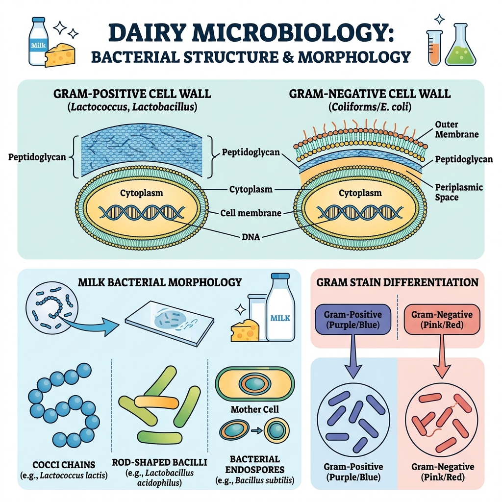
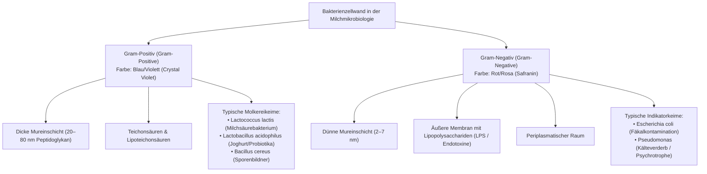

# Tag 02: Grundlagen der Mikrobiologie (Fundamentals of Microbiology)
**Datum:** 07. Oktober 2026 | **Fach:** Semester I – Grundlagen der Mikrobiologie  
**Thema:** Bakterienzellstruktur, Gram-Färbung und die typische Mikroflora der Milch *(Bacterial Structure, Gram Staining & Milk Microflora)*

---

## 🖼️ Wissenschaftliche Infografik (Microbiology Infographic)

Hier ist die mikrobiologische Übersicht über bakterielle Zellwände und Keimarten in der Milch:

---

## 1. Fachwortschatz des Tages (Vocabulary of the Day)

Lerne diese Fachbegriffe mit Artikel (**der**, **die**, **das**) und Plural:

| Deutscher Begriff (mit Artikel) | Plural | Englische Übersetzung | Wissenschaftliche Definition |
| :--- | :--- | :--- | :--- |
| **das Bakterium** | die Bakterien | bacterium (pl. bacteria) | Prokaryotischer einzelliger Mikroorganismus ohne Zellkern. |
| **die Zellwand** | die Zellwände | cell wall | Formgebende, schützende Hülle außerhalb der Plasmamembran. |
| **das Murein (das Peptidoglykan)**| - | peptidoglycan / murein | Polymer aus Zuckern und Aminosäuren, das die Zellwand bildet. |
| **die Gram-Färbung** | die Gram-Färbungen | Gram stain | Differenzierungsverfahren (Gram-positiv vs. Gram-negativ). |
| **das Milchsäurebakterium (MSB)** | die Milchsäurebakterien (LAB) | lactic acid bacterium | Fermentiert Laktose zu Milchsäure (*Lactococcus, Lactobacillus*). |
| **die Kokke** | die Kokken | coccus (pl. cocci) | Kugelförmiges Bakterium (z.B. Ketten bei *Streptococcus*). |
| **das Stäbchenbakterium** | die Stäbchenbakterien | bacillus / rod-shaped bacterium | Zylinderförmige Bakterienzelle (z.B. *Lactobacillus*). |
| **die Endospore** | die Endosporen | bacterial endospore | Extrem hitzeresistente Dauerform (z.B. *Bacillus*, *Clostridium*). |
| **die Rohmilchflora** | - | raw milk microflora | Gesamtheit aller nativen Mikroorganismen in unbehandelter Milch. |
| **die Pasteurisierung** | die Pasteurisierungen | pasteurization | Hitzebehandlung zur Abtötung vegetativer pathogener Keime. |

---

## 2. Der entscheidende Unterschied: Gram-positiv vs. Gram-negativ

In der Molkerei unterscheidet man zwei Hauptgruppen von Bakterien anhand ihrer Zellwandarchitektur:

### Das Prinzip der Gram-Färbung (Schritt für Schritt):
1. **Kristallviolett (Crystal Violet):** Färbt alle Zellen dunkelblau/violett.
2. **Lugolsche Lösung (Iodine):** Bildet einen wasserunlöslichen Iod-Farbstoff-Komplex in den Poren des Peptidoglykans.
3. **Entfärbung mit Ethanol/Aceton (Decolorization):**
   - Bei **Gram-negativen** Zellen löst der Alkohol die Lipidmembran auf $\rightarrow$ Farbstoff wird ausgewaschen (Zelle wird farblos).
   - Bei **Gram-positiven** Zellen dehydriert der Alkohol die dicke Mureinschicht $\rightarrow$ Poren schließen sich, der blaue Farbstoff bleibt fest gefangen!
4. **Gegenfärbung mit Safranin / Fuchsin (Counterstaining):** Die entfärbten Gram-negativen Bakterien färben sich hellrot/rosa.

---

## 3. Die drei wichtigsten bakteriellen Gruppen in der Molkerei

### 1. Nützliche Milchsäurebakterien (LAB - Lactic Acid Bacteria)
- **Gram-Status:** Fast ausnahmslos **Gram-positiv**.
- **Wichtigste Gattungen:** *Lactococcus lactis*, *Lactobacillus delbrueckii subsp. bulgaricus*, *Streptococcus thermophilus*.
- **Funktion:** Spalten Laktose über den Embden-Meyerhof-Parnas-Weg (homofermentativ) oder Phosphoketolase-Weg (heterofermentativ) zu **Milchsäure ($\text{CH}_3\text{-CHOH-COOH}$)**.
- **Folge:** Der pH-Wert sinkt von 6,7 auf unter 4,6. Dies inhibiert Fäulnisbakterien und dickt das Kasein ein (Joghurt, Käse, Sauermilch).

### 2. Kälte- und Verderbserreger (Psychrotrophe Keime)
- **Gram-Status:** Überwiegend **Gram-negativ** (z.B. *Pseudomonas fluorescens*).
- **Gefahr:** Wachsen selbst im Milchkühltank bei $4\ ^\circ\text{C}$. Sie bilden hitzestabile Enzyme (**Proteasen** und **Lipasen**), die selbst die Pasteurisierung überleben und nach Wochen bittere oder ranzige Fehlaromen in H-Milch verursachen!

### 3. Sporenbildner (Spore-forming Bacteria)
- **Gram-Status:** **Gram-positiv** (Gattungen: *Bacillus* [aerob] und *Clostridium* [anaerob]).
- **Endosporen:** Überleben normale Kurzzeiterhitzung ($72\ ^\circ\text{C}$ für 15 s).
- **Problem im Betrieb:** *Bacillus cereus* verursacht Süßgerinnung (Bitty Cream); *Clostridium tyrobutyricum* erzeugt Buttersäuregärung und Blähung in gereiftem Schnittkäse ("Spätblähung").

---

## 4. Molkereipraxis & Keimreduktion (Dairy Engineering)

| Verfahren (Process) | Temperatur & Zeit | Zielkeime & Wirkung |
| :--- | :--- | :--- |
| **Thermisation** | $60 - 65\ ^\circ\text{C}$ (15–20 s) | Vorübergehende Keimreduktion vor der Käsereifung ohne Enzymdenaturierung. |
| **Kurzzeiterhitzung (KZE / HTST)**| $72 - 75\ ^\circ\text{C}$ (15–30 s) | Tötet alle vegetativen Pathogene (z.B. *Salmonella, Listeria, Mycobacterium tuberculosis*). |
| **Ultrahocherhitzung (UHT)** | $135 - 150\ ^\circ\text{C}$ (2–4 s) | Kommerzielle Sterilität: Inaktiviert selbst resistente bakterielle Endosporen. |
| **Bakteriofugen (Bactofugation)** | Zentrifugation bei $60\ ^\circ\text{C}$ | Physikalische Abtrennung schwerer Sporen durch Fliehkraft vor der Käseherstellung. |

---

## 5. Übung & Selbsttest (Daily Recall Quiz)

1. **Grammatik:** Welches Genus haben diese Begriffe?
   - `___` Bakterium
   - `___` Zellwand
   - `___` Spore
   *(Antwort: das Bakterium, die Zellwand, die Spore)*

2. **Mikrobiologie:** Warum bleiben Milchsäurebakterien bei der Gram-Färbung dunkelblau/violett?
   *(Antwort: Sie sind Gram-positiv und besitzen eine dicke Peptidoglykan-/Mureinschicht, die das Kristallviolett-Iod-Gemisch nach der Ethanolbehandlung zurückhält.)*

3. **Technologie:** Warum reicht die Standard-Pasteurisierung ($72\ ^\circ\text{C}$) nicht aus, um bakterielle Endosporen abzutöten?
   *(Antwort: Weil Endosporen durch ihren dehydrierten Kern, Dipicolinsäure und feste Sporenhüllen extrem hitzestabil sind. Zur Zerstörung ist UHT mit über $135\ ^\circ\text{C}$ oder Autoklavieren nötig.)*
