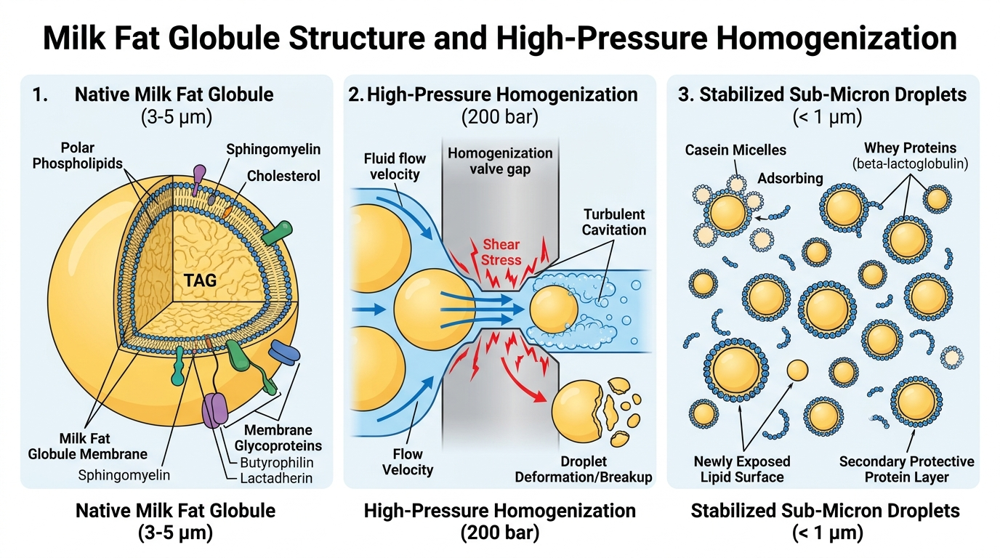
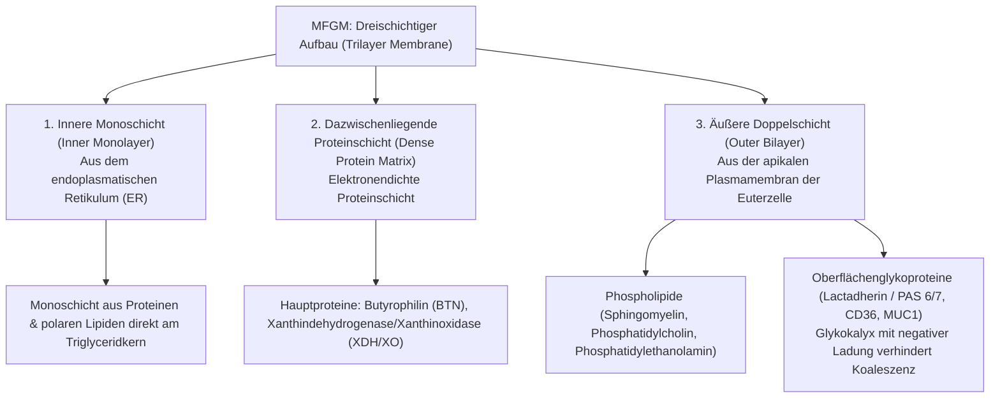
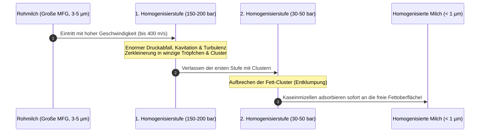

# Tag 03: Physikalische Chemie der Milch (Physical Chemistry of Milk)
**Datum:** 26. Oktober 2026 | **Fach:** Semester I – Physikalische Chemie der Milch  
**Thema:** Das Milchfettkügelchen, die MFGM (Milchfettkügelchenmembran), Emulsionsstabilität & Hochdruckhomogenisierung *(Milk Fat Globule Structure, MFGM, Emulsion Rheology & High-Pressure Homogenization)*

---

## 🖼️ Wissenschaftliche Infografik (Microstructural & Process Infographic)

Hier ist die mikrostrukturelle Übersicht über das native Milchfettkügelchen, die Dreischichten-Membran (MFGM) und den Homogenisierungsprozess im Hochdruckventil:

---

## 1. Fachwortschatz des Tages (Vocabulary of the Day)

Lerne diese Fachbegriffe mit Artikel (**der**, **die**, **das**) und Plural:

| Deutscher Begriff (mit Artikel) | Plural | Englische Übersetzung | Wissenschaftliche Definition |
| :--- | :--- | :--- | :--- |
| **das Milchfettkügelchen (MFG)** | die Milchfettkügelchen | milk fat globule | Sphärisches Lipidpartikel (0,1–15 µm) mit Triglyceridkern. |
| **die Milchfettkügelchenmembran (MFGM)** | die Membranen | milk fat globule membrane | Dreischichtige biologische Schutzhülle aus Lipiden und Glykoproteinen. |
| **das Triacylglycerid (das Triglycerid)** | die Triglyceride | triacylglycerol (TAG) | Ester des Glycerins mit 3 Fettsäuren (bildet > 98 % des Milchfetts). |
| **das Phospholipid** | die Phospholipide | phospholipid | Amphiphiles Membranlipid (Sphingomyelin, Phosphatidylcholin). |
| **die Hochdruckhomogenisierung** | die Homogenisierungen | high-pressure homogenization | Mechanische Druckzerkleinerung (150–250 bar) zur Verhinderung des Aufrahmens. |
| **das Homogenisierventil** | die Ventile | homogenizing valve | Spaltventil, in dem Scherung, Turbulenz und Kavitation wirken. |
| **die Kavitation** | die Kavitationen | cavitation | Bildung und implosives Kollabieren von Dampfblasen durch Druckabfall. |
| **die Lipolyse (die Ranzigkeit)** | - | lipolysis / hydrolytic rancidity | Enzymatische Spaltung von Triglyceriden in freie Fettsäuren (FFA). |
| **die Lipase (Lipoproteinlipase, LPL)**| die Lipasen | lipase | Natives milcheigenes Enzym, das Fett hydrolysiert, wenn die Membran verletzt ist. |
| **die Koaleszenz** | - | coalescence | Verschmelzen kleiner Fettkügelchen zu größeren Tropfen (Emulsionsbruch). |

---

## 2. Anatomie des Milchfettkügelchens (Anatomy of the Milk Fat Globule)

### 2.1 Der Kern (The Lipid Core)
- **Zusammensetzung:** Über 98 % Triacylglyceride (TAG).
- **Schmelzverhalten (Melting Range):** Milchfett hat keinen scharfen Schmelzpunkt, sondern einen breiten Schmelzbereich von ca. **$-40\ ^\circ\text{C}$ bis $+40\ ^\circ\text{C}$**.
  - Bei Raumtemperatur ($20\ ^\circ\text{C}$) liegen flüssiges Öl und feste Fettkristalle nebeneinander vor.
  - Kristallisation beginnt oft an der inneren Membrangrenze.

### 2.2 Die Dreischichten-Architektur der MFGM (The Trilayer MFGM Structure)
Die MFGM ist kein simples Tensid, sondern ein lebendes biologisches Membransystem, das von der sekretorischen Zelle des Euters abgeschnürt wurde:

---

## 3. Hochdruckhomogenisierung (High-Pressure Homogenization)

### Warum wird Milch homogenisiert?
1. **Verhinderung des Aufrahmens (Prevention of Creaming):** Nach dem Stokes'schen Gesetz sinkt die Aufrahmgeschwindigkeit $v \propto r^2$. Durch die Verkleinerung des Durchmessers von durchschnittlich $3{,}5\ \mu\text{m}$ auf unter $0{,}7\ \mu\text{m}$ wird das Aufrahmen über Wochen unterbunden.
2. **Verbesserte Textur & Optik:** Mehr Fettkügelchen = stärkere Lichtstreuung $\rightarrow$ die Milch wirkt weißer und schmeckt vollmundiger.
3. **Verminderte Oxidationsempfindlichkeit:** Durch Bindung von Proteinen an der Grenzfläche.

### Der Grenzflächen-Effekt (Surface Area Explosion & Membrane Reconstitution)
- Vor der Homogenisierung beträgt die Fettoberfläche ca. $80\ \text{m}^2$ pro Liter Milch.
- Nach der Homogenisierung vergrößert sich die Oberfläche auf **$300 - 400\ \text{m}^2$ pro Liter** (Faktor 4 bis 5)!
- Da nicht genügend native MFGM vorhanden ist, um diese riesige neue Oberfläche zu bedecken, **adsorbieren sofort Kaseine (Kasein-Submizellen) und Molkenproteine** aus dem Serum an die Fettoberfläche.
- **Ergebnis:** Das homogenisierte Fettkügelchen verhält sich wie ein großes Kaseinteilchen ("Pseudoprotein-Kügelchen")!

---

## 4. Das Risiko der Lipolyse (The Critical Risk of Lipolysis)

> [!WARNING] Breaking Rule: Homogenization must ALWAYS be combined with Heat Treatment!
> Native Rohmilch enthält das Enzym **Lipoproteinlipase (LPL)**. Solange die MFGM intakt ist, kann die Lipase nicht an das Kernfett gelangen.
> Wird Rohmilch kalt homogenisiert oder stark mechanisch geschert, wird die Membran zerstört. Die Lipase spaltet sofort Triglyceride in **freie Fettsäuren (Free Fatty Acids - FFA)** wie Buttersäure ($\text{C}_4$), Capronsäure ($\text{C}_6$) und Caprylsäure ($\text{C}_8$).
> **Folge:** Innerhalb weniger Minuten schmeckt die Milch extrem ranzig, beißend und seifig!
> **Industrielösung:** Milch muss unmittelbar vor oder direkt nach der Homogenisierung pasteurisiert werden ($> 72\ ^\circ\text{C}$), um die Lipase thermisch zu inaktivieren!

---

## 5. Übung & Selbsttest (Daily Recall Quiz)

1. **Grammatik & Genus:** Setze den richtigen Artikel ein:
   - `___` Milchfettkügelchen
   - `___` Homogenisierung
   - `___` Phospholipid
   *(Antworten: das Milchfettkügelchen, die Homogenisierung, das Phospholipid)*

2. **Verfahrenstechnik:** Warum besitzt ein industrieller Homogenisator fast immer **zwei Stufen** (z.B. Stufe 1: 180 bar, Stufe 2: 40 bar)?
   *(Antwort: Die erste Stufe zerkleinert die Fettkügelchen unter hohem Druck; dabei neigen die Tröpfchen dazu, Agglomerate (Cluster) zu bilden. Die zweite Stufe bricht diese Fett-Cluster auf und sorgt für eine gleichmäßige Dispersion.)*

3. **Lebensmittelchemie:** Warum werden homogenisierte Fettkügelchen auch als "Pseudoprotein-Partikel" bezeichnet?
   *(Antwort: Weil sich die Fettoberfläche um das 4- bis 5-fache vergrößert und die neue Oberfläche fast vollständig von Kaseinmizellen und Molkenproteinen aus dem Serum überzogen wird.)*

---

### Deutsche Fachsätze zum Merken (Key Phrases):
- *"Die Milchfettkügelchenmembran (MFGM) besteht aus einer inneren Monoschicht und einer äußeren Doppelschicht."*
- *"Die Hochdruckhomogenisierung verringert den Durchmesser der Fettkügelchen auf unter einen Mikrometer."*
- *"Durch die Homogenisierung adsorbieren Kaseine an der neu gebildeten Fett-Serum-Grenzfläche."*
- *"Homogenisierung ohne vorherige oder gleichzeitige Pasteurisierung führt zu sofortiger hydrolytischer Ranzigkeit."*
