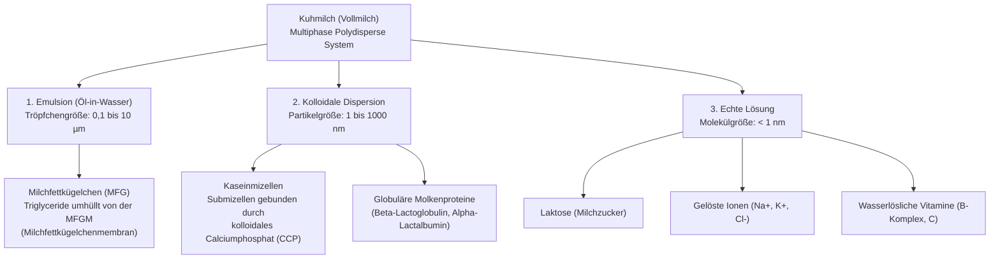

# Semester I: Physikalische Chemie der Milch (Physical Chemistry of Milk)
## Lektion 01: Definition, Zusammensetzung und das kolloidale Mehrphasensystem der Milch
*(Lesson 01: Definition, Gross Composition, and the Multiphase Colloidal System of Milk)*

---

## 1. Fachwortschatz des Tages (Vocabulary of the Day)

Lerne diese Schlüsselwörter immer mit Artikel (**der**, **die**, **das**) und Pluralform:

| Deutscher Begriff (mit Artikel) | Plural | Englische Übersetzung | Wissenschaftliche Bedeutung |
| :--- | :--- | :--- | :--- |
| **die Milch** | *meist Sg.* | milk | Das physiologische Sekret der Milchdrüse (mammary gland). |
| **die Trockenmasse (TM)** | die Trockenmassen | total solids (TS) | Alle Bestandteile der Milch nach vollständigem Wasserentzug. |
| **die fettfreie Trockenmasse (FFT)** | die fettfreien Trockenmassen | solids-not-fat (SNF) | Trockenmasse abzüglich des Milchfetts (Proteine, Laktose, Mineralien). |
| **das Milchfett** | - | milk fat / butterfat | Lipide, überwiegend Triglyceride (Triacylglycerole). |
| **das Kasein** | die Kaseine | casein | Hauptprotein der Milch (ca. 80 % des Gesamteiweißes). |
| **das Molkenprotein** | die Molkenproteine | whey protein | Säure- und hitzelösliche Proteine (ca. 20 % des Milcheiweißes). |
| **die Laktose (der Milchzucker)** | - | lactose (milk sugar) | Das primäre Disaccharid in der Milch (Glucose + Galaktose). |
| **die Emulsion** | die Emulsionen | emulsion | Heterogenes Gemisch zweier nicht mischbarer Flüssigkeiten (Fett in Wasser). |
| **die kolloidale Dispersion** | die Dispersionen | colloidal dispersion | Verteilung von Teilchen mit einer Größe von 1 bis 1000 nm (Kaseinmizellen). |
| **die echte Lösung** | die Lösungen | true solution | Homogene Mischung auf molekularer/ionischer Ebene (< 1 nm). |

---

## 2. Kernwissen & Theorie (Scientific Principles)

### 2.1 Chemische Definition der Milch (Chemical Definition of Milk)
> **Deutsch:**  
> Milch ist ein komplexes, polydisperses biologisches Mehrphasensystem. Physiko-chemisch betrachtet besteht sie aus einer wässrigen Phase, in der verschiedene Komponenten gelöst, dispergiert oder emulgiert vorliegen.

> **English:**  
> Milk is a complex, polydisperse biological multiphase system. Physicochemically, it consists of a continuous aqueous phase in which various constituents exist in true solution, colloidal dispersion, or coarse emulsion.

---

### 2.2 Durchschnittliche Zusammensetzung von Kuhmilch (Gross Composition of Bovine Milk)

Im Durchschnitt setzt sich mitteleuropäische Kuhmilch wie folgt zusammen:

| Bestandteil (Component) | Typischer Gehalt (%) | Bereich (Range %) | Physikalische Form (Physical State) |
| :--- | :---: | :---: | :--- |
| **Wasser (Water)** | **87,3 %** | 85,5 – 89,5 % | Kontinuierliche Phase (Lösungsmittel) |
| **Milchfett (Fat)** | **3,9 %** | 3,2 – 5,0 % | **Emulsion** (Fettkügelchen: 0,1 – 15 µm) |
| **Milcheiweiß (Total Protein)** | **3,3 %** | 2,9 – 3,7 % | **Kolloidale Dispersion** & Echte Lösung |
| ↳ *davon Kaseine (Caseins)* | *2,6 %* | *(ca. 80 % des Proteins)* | Kolloidale Mizellen (50 – 300 nm) |
| ↳ *davon Molkenproteine (Whey)* | *0,7 %* | *(ca. 20 % des Proteins)* | Kolloidal gelöst / Nanoteilchen |
| **Laktose (Lactose / Milchzucker)**| **4,7 %** | 4,4 – 5,2 % | **Echte Lösung** (Molekular gelöst) |
| **Mineralstoffe / Asche (Ash)** | **0,7 %** | 0,65 – 0,75 % | Echte Lösung (Ionen) & Kolloidal (Salze) |
| **Fettfreie Trockenmasse (SNF)**| **8,8 %** | 8,2 – 9,3 % | Proteine + Laktose + Mineralien |

$$\text{Trockenmasse (TS)} = \text{Milchfett} + \text{Fettfreie Trockenmasse (SNF)}$$

---

### 2.3 Die drei physikalischen Zustände (The Three Physical States of Milk)

Milch ist gleichzeitig eine **Emulsion**, eine **kolloidale Dispersion** und eine **echte Lösung**:

1. **Die Emulsion (Fettphase / Fat phase):**
   - Das Milchfett liegt als Öl-in-Wasser-Emulsion ($O/W$) vor.
   - Die Fetttröpfchen sind von einer biologischen Membran umgeben: der **Milchfettkügelchenmembran (MFGM - Milk Fat Globule Membrane)**.
   - Diese Membran enthält Phospholipide, Proteine und Enzyme und verhindert das spontane Zusammenfließen (*Koaleszenz / Coalescence*) der Fettkügelchen.

2. **Die kolloidale Suspension (Proteinphase / Colloidal Protein Phase):**
   - Kaseine liegen nicht als freie Moleküle vor, sondern bilden sphärische Komplexe: **Kaseinmizellen (Casein Micelles)**.
   - Sie streuen das einfallende Licht (**Tyndall-Effekt**), was der Milch ihr typisches weißes, opakes Aussehen verleiht.
   - Stabilisiert werden sie durch die hydrophile Schicht aus $\kappa$-Kasein (*Kappa-Kasein*) an der Oberfläche der Mizelle.

3. **Die echte Lösung (Serumphase / Serum Phase):**
   - Molekular und ionisch dispers: Laktose, Salze ($Na^+, K^+, Cl^-$), Spurenelemente und organische Säuren (z. B. Citrat).
   - Verursacht den osmotischen Druck und bestimmt die **Gefrierpunktserniedrigung** der Milch.

---

## 3. Physikalische Kenngrößen (Key Physical Properties of Milk)

Diese Werte sind entscheidend für Qualitätskontrolle und Prozessführung in der Molkerei:

| Eigenschaft (Property) | Standardwert bei 20 °C | Technologische Bedeutung |
| :--- | :--- | :--- |
| **Dichte ($\rho$)** | $1{,}028 - 1{,}034\text{ g/cm}^3$ | Dient der Berechnung des Trockenmassegehalts und der Detektion von Wasserzusatz. |
| **pH-Wert** | $6{,}6 - 6{,}8$ | Zeigt die Frische der Milch an. Ein pH < 6,5 deutet auf bakterielle Säuerung (Milchsäuregärung) hin. |
| **Titrierbare Säure** | $6{,}5 - 7{,}5\ ^\circ\text{SH}$ (Soxhlet-Henkel) | Maß für die Pufferkapazität durch Kaseine, Phosphate und Citrate. |
| **Gefrierpunkt ($T_f$)** | $-0{,}520 \text{ bis } -0{,}540\ ^\circ\text{C}$ | Streng regulierter Grenzwert. Bei Zusatz von Fremdwasser steigt der Gefrierpunkt Richtung $0\ ^\circ\text{C}$. |
| **Viskosität ($\eta$)** | $1{,}5 - 2{,}0\text{ mPa}\cdot\text{s}$ | Bestimmt Druckverluste in Rohren und das Pumpverhalten (Strömungsmechanik). |

---

## 4. Industrielle Anwendung (Dairy Engineering Application)

### Warum ist das kolloidale System in der Molkerei so wichtig?

1. **Entrahmung (Centrifugal Separation):**  
   Da Milchfett eine geringere Dichte ($\approx 0{,}93\text{ g/cm}^3$) als das Milchserum ($\approx 1{,}036\text{ g/cm}^3$) besitzt, schwimmen die Fettkügelchen nach dem Stoke'schen Gesetz langsam nach oben (*Aufrahmen*). In der Molkerei wird dieser Vorgang in Zentrifugen (Separatoren) bei $55 - 65\ ^\circ\text{C}$ um den Faktor tausend beschleunigt, um Magermilch und Rahm zu trennen.

2. **Homogenisierung (Homogenization):**  
   Durch hohen Druck (150 – 250 bar) werden die Fettkügelchen von einem mittleren Durchmesser von ca. $4\ \mu\text{m}$ auf unter $1\ \mu\text{m}$ zerkleinert. Die vergrößerte Oberfläche wird sofort durch Kaseine und Serumproteine neu stabilisiert, sodass die Milch nicht mehr aufrahmt.

3. **Gefrierpunkt-Kryoskopie (Cryoscopy for Water Adulteration):**  
   Da nur die gelösten Stoffe (Laktose und Mineralsalze) den osmotischen Druck und damit den Gefrierpunkt bestimmen, hat natürliche Rohmilch einen sehr konstanten Gefrierpunkt. Wenn ein Lieferant Wasser hinzufügt, wird die Lösung verdünnt und der Gefrierpunkt steigt näher an $0\ ^\circ\text{C}$.

---

## 5. Übung & Aktives Abrufen (Practice & Daily Recall Quiz)

### Frage 1: Fachwörter & Grammatik (German Vocabulary & Grammar)
Setze den richtigen bestimmten Artikel (**der**, **die**, oder **das**) und das Wort ein:
1. `____` (emulsion) in der Milch besteht aus Fettkügelchen.
2. `____` (casein) bildet kolloidale Mizellen.
3. `____` (density) von Kuhmilch liegt bei etwa $1{,}030\text{ g/cm}^3$.

*Antworten:*  
1. *Die* Emulsion  
2. *Das* Kasein  
3. *Die* Dichte  

### Frage 2: Physikalische Chemie (Science Question)
In welcher physikalischen Phase (echte Lösung, kolloidale Dispersion oder Emulsion) liegen die folgenden Bestandteile der Milch vor?
- a) Laktose (Milchzucker)
- b) $\kappa$-Kasein
- c) Triacylglyceride (Milchfett)
- d) Natrium- und Chlorid-Ionen

*Antworten:*  
- a) Echte Lösung  
- b) Kolloidale Dispersion  
- c) Emulsion  
- d) Echte Lösung  

### Frage 3: Molkereipraxis (Practical Engineering Question)
Warum steigt der Gefrierpunkt der Milch an, wenn unzulässigerweise Wasser hinzugefügt wird?  
*Antwort:*  
Weil die Konzentration der osmotisch aktiven, gelösten Teilchen (hauptsächlich Laktose und Mineralsalze) sinkt. Nach dem Gesetz der Gefrierpunktserniedrigung ($\Delta T_f = K_f \cdot b$) führt eine geringere molale Konzentration zu einer geringeren Absenkung, der Gefrierpunkt verschiebt sich also näher gegen $0\ ^\circ\text{C}$.

---

### Deutsche Fachsätze zum Merken (German Phrases to Memorize):
- *"Milch ist ein polydisperses Mehrphasensystem."* (Milk is a polydisperse multiphase system.)
- *"Die Fettkügelchen werden durch die Milchfettkügelchenmembran stabilisiert."* (The fat globules are stabilized by the milk fat globule membrane.)
- *"Kaseinmizellen streuen das Licht und erzeugen die weiße Farbe."* (Casein micelles scatter light and cause the white color.)
